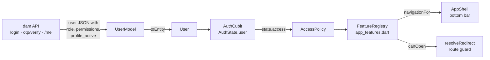
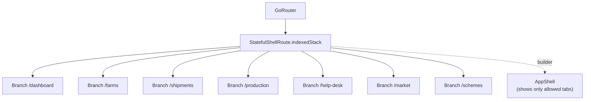
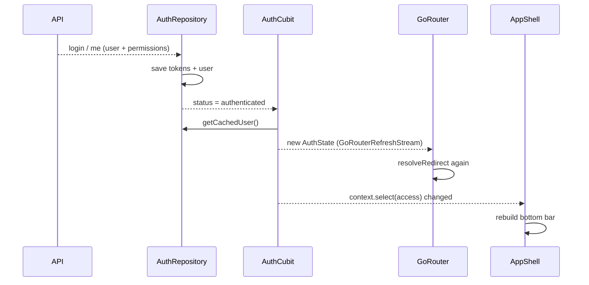

# Navigation & Access

How the app decides **what a signed-in user can see and open**, and how the
**bottom bar** is built from that. Nothing is hardcoded per role: the backend
says what the user may do, and every screen declares what it needs.

---

## 1. The big picture



1. The API returns the user with their **role**, **effective permissions** and
   whether their **profile is active**.
2. The app turns that into an **`AccessPolicy`** ("what this user may do").
3. Every destination in the app is listed once in **`app_features.dart`** with
   an **`AccessRule`** ("what this destination needs").
4. The **bottom bar** shows the allowed destinations that are tabs; the
   **router** blocks any route the user may not open.
5. When the user changes (login, logout, `/me` refresh), both update by
   themselves.

---

## 2. What the backend sends

`UserResource` (`dam/app/Http/Resources/UserResource.php`) is returned by
`POST /api/v1/login`, `POST /api/v1/otp/verify` (inside `data.user`) and
`GET /api/v1/me` (as `data`):

```json
{
  "id": "01m6de2ppp3mndabp9k5gpq9r3",
  "name": "Sample Farmer",
  "role": { "value": "farmer", "label": "Farmer" },
  "permissions": ["shipments.request"],
  "profile_active": true,
  "password_change_required": false
}
```

| Field | Meaning |
|---|---|
| `role.value` | One of `super-admin`, `admin`, `state_officer`, `district_officer`, `call_center_agent`, `farmer`, `vendor`, `driver` (`App\Enums\UserRole`) |
| `permissions` | The user's **effective** permissions, sorted. Named `<module>.<feature>` (`config/access.php`), e.g. `markets.view`, `helpdesk.manage`, `shipments.drive` |
| `profile_active` | `true` when the farmer / vendor / driver profile the role works through exists and is active. Always `false` for other roles |

**Effective permissions** are computed by the backend (`PermissionService::effective`):

```
role permissions (defaults, or as edited in the admin panel)
  + permissions granted to this user
  − permissions denied to this user
super-admin → every permission
```

So an admin can change what a role or a single user may do, and the app picks
it up on the next login or `/me` — no app release needed.

**Why `profile_active` exists:** some API routes check more than a permission.
`farmer/*` needs an active farmer profile (`farmer.profile` middleware) and the
shipment routes need the matching role *and* an active vendor/driver profile
(`shipment.party` middleware). The app mirrors that so it never shows a screen
whose API calls would return `403`.

---

## 3. Where it lives in the app

| Layer | File | Role |
|---|---|---|
| Data | `lib/data/auth/model/user_model.dart` | Parses `permissions`, `profile_active` (generated with `sf make model --update`) |
| Data | `lib/data/auth/mappers/auth_mappers.dart` | `UserModel` → `User` (missing fields → empty / `false`) |
| Domain | `lib/domain/auth/entities/user.dart` | `User.permissions` (`Set<String>`), `User.profileActive` |
| Domain | `lib/domain/auth/entities/access_rule.dart` | `AccessRule` — what a destination needs |
| Domain | `lib/domain/auth/entities/access_policy.dart` | `AccessPolicy` — what the user may do; `Roles`, `Permissions` constants |
| Domain | `lib/domain/auth/use_cases/get_current_user.dart` | Reads the cached user |
| Session | `lib/features/auth/session/bloc/auth_cubit.dart` / `auth_state.dart` | Holds `status` + `user`; `state.access` |
| App | `lib/app/access/feature_registry.dart` | `AppFeature`, `AppTab`, `FeatureRegistry` (tabs, More, guard) |
| App | `lib/app/access/app_features.dart` | **The table of every destination** |
| App | `lib/app/shell/app_shell.dart` | Bottom bar built per user |
| App | `lib/app/shell/tab_placeholder_screen.dart` | Stand-in for tabs not built yet |
| App | `lib/app/shell/app_shell_route.dart` | Shell route (`buildAppShellRoute`) |
| App | `lib/app/shell/tab_routes.dart` | Tab routes by path (`appTabRoutes`), the project's own |
| App | `lib/app/router/app_router.dart` | Uses the shell route; guard (`resolveRedirect`) |
| UI | `lib/core/ui/widgets/app_bottom_bar.dart` | The bar itself (2–5 items, badges) |

---

## 4. `AccessPolicy` — what the user may do

Built from the signed-in user:

```dart
final access = context.read<AuthCubit>().state.access;   // AccessPolicy

access.isSignedIn;        // true
access.role;              // 'farmer'
access.permissions;       // {'shipments.request'}
access.profileActive;     // true
access.can(Permissions.shipmentsRequest);   // true
```

| Session | `state.access` |
|---|---|
| Not signed in | `AccessPolicy.guest` — only public rules pass |
| Signed in, user loaded | `AccessPolicy.fromUser(user)` |
| Signed in, user could not be read | `AccessPolicy.signedInWithoutDetails` — public + signed-in rules pass |

`AuthCubit` loads the user from the cache every time the session becomes
authenticated, and clears it on logout. Call `authCubit.refreshUser()` after
`/me` has saved a fresh user.

---

## 5. `AccessRule` — what a destination needs

| Rule | Passes when |
|---|---|
| `AccessRule.public()` | always |
| `AccessRule.signedIn()` | the user is signed in |
| `AccessRule.role(Roles.farmer)` | signed in **and** role is `farmer` |
| `AccessRule.permission(Permissions.helpdeskManage)` | signed in **and** has the permission |
| `AccessRule.profile()` | signed in **and** `profile_active` is true |
| `AccessRule.any([...])` | at least one rule passes |
| `AccessRule.all([...])` | every rule passes (an empty list never passes) |

Examples from the app:

```dart
// Farms: a farmer with an active farmer profile
AccessRule.all([AccessRule.role(Roles.farmer), AccessRule.profile()])

// Production: either permission
AccessRule.any([
  AccessRule.permission(Permissions.productionView),
  AccessRule.permission(Permissions.productionManage),
])

// Driver shipments: role + profile + permission (mirrors `shipment.party`)
AccessRule.all([
  AccessRule.role(Roles.driver),
  AccessRule.profile(),
  AccessRule.permission(Permissions.shipmentsDrive),
])
```

Use rules anywhere in the UI too, e.g. to hide a button:

```dart
if (access.allows(const AccessRule.permission(Permissions.noticesManage)))
  IconButton(icon: const Icon(PhosphorIconsRegular.plus), onPressed: create),
```

---

## 6. The feature table (`app_features.dart`)

Every destination is one `AppFeature`:

```dart
const AppFeature(
  id: 'farms',                         // unique
  path: '/farms',                      // route it owns (and everything below it)
  rule: _farmer,                       // who may use it
  title: _farms,                       // l10n title: (l10n) => l10n.farms
  icon: PhosphorIconsRegular.plant,    // used in More / quick actions
  tab: AppTab(                         // omit → not a bottom bar tab
    icon: PhosphorIconsRegular.plant,
    activeIcon: PhosphorIconsFill.plant,
    priority: 10,                      // lower = further left
  ),
),
```

Current table:

| id | path | rule | tab (priority) |
|---|---|---|---|
| `home` | `/dashboard` | signed in | ✓ (0) |
| `farms` | `/farms` | farmer + profile | ✓ (10) |
| `farmer_shipments` | `/shipments` | farmer + profile + `shipments.request` | ✓ (10) |
| `vendor_shipments` | `/shipments` | vendor + profile + `shipments.handle` | ✓ (10) |
| `driver_shipments` | `/shipments` | driver + profile + `shipments.drive` | ✓ (10) |
| `production` | `/production` | `production.view` or `production.manage` | ✓ (10) |
| `help_desk_queue` | `/help-desk` | `helpdesk.manage` | ✓ (10) |
| `market` | `/market` | public | ✓ (20) |
| `schemes` | `/schemes` | public | ✓ (30) |
| `support` | `/support` | farmer + profile | — |
| `crops` | `/crops` | public | — |
| `notices` | `/notices` | public | — |
| `manage_notices` | `/admin/notices` | `notices.manage` | — |
| `manage_alerts` | `/admin/alerts` | `alerts.manage` | — |
| `profile` | `/profile` | signed in | — (account button in the top bar) |

Three features share `/shipments` with different rules: whichever party the
user is, they get one Shipments tab.

---

## 7. How the bottom bar is built

`appFeatures.navigationFor(access)`:

1. Keep the features whose **rule allows** the user.
2. Keep those that have a **`tab`**.
3. **Sort by `priority`** (ties keep table order).
4. **One tab per path** (the three shipment features → one tab).
5. **≤ 5 tabs** → show them all. **> 5** → show the first 4 and turn the last
   slot into **More**, which lists the rest.

Features without a tab are returned by `appFeatures.secondary(access)` for the
home screen's quick actions and menus.

What each role gets today (backend default permissions):

| Role | Bottom bar |
|---|---|
| Farmer, active profile | Home · Farms · Shipments · Market · Schemes |
| Farmer, no profile | Home · Market · Schemes |
| Vendor / Driver | Home · Shipments · Market · Schemes |
| Call centre agent | Home · Help desk · Market · Schemes |
| District officer | Home · Production · Market · Schemes |
| Admin / Super admin | Home · Production · Help desk · Market · Schemes |

---

## 8. The shell (`AppShell`)



- go_router's **`StatefulShellRoute.indexedStack`**: each tab keeps its own
  navigation stack and scroll position.
- The **branches are fixed** — one per `appFeatures.tabPaths`, for everyone.
  They are built lazily, so a tab the user never opens costs nothing.
- **`AppShell` decides which of them appear** in the bar by mapping each
  allowed tab to its branch index. Because branches never change, access can
  change while the app is running without rebuilding the router.
- A tab whose feature is not built yet shows `TabPlaceholderScreen`. When a
  feature is built, add its routes to `appTabRoutes()` in
  `lib/app/shell/tab_routes.dart`.

Behaviour:

| Action | Result |
|---|---|
| Tap a tab | Opens that branch where the user left it |
| Tap the current tab again | Returns that branch to its first screen |
| Tap **More** | `ConfirmSheet.choose` with the overflow destinations; More stays selected while one of them is open |
| Android back on a tab other than Home | Goes to Home first, then exits |
| Fewer than 2 destinations | No bottom bar |

---

## 9. The route guard (`resolveRedirect`)

Runs on every navigation and whenever `AuthCubit` emits:

```
1. Update required        → /force-update
2. Status unknown         → /splash
3. Not signed in          → /login (only /login allowed)
4. Signed in:
     on splash / force-update / login → /dashboard
     on /dashboard                    → stay (never redirected → no loops)
     appFeatures.canOpen(location) is false → /dashboard
     otherwise                        → stay
```

`canOpen(location, access)`:

- Ignores the query string (`/farms?tab=crops` → `/farms`).
- Finds the features that own the path (`/farms` owns `/farms/01ABC/crops`)
  and uses the **most specific** one (`/admin/notices` beats `/notices`).
- If **any** owner allows the user → open.
- A path **no feature claims** (login, splash, `/ui_gallery`) is left to the
  router and passes.

So a deep link or notification that points a driver at `/farms/...` lands on
Home instead of a screen full of `403` errors.

---

## 10. Live updates



- **Login / OTP verify:** the repository saves the user, then reports
  `authenticated`; the cubit loads the user and emits it.
- **`/me` refresh:** save the new user, then `authCubit.refreshUser()`.
- **Logout / session expiry (401):** status → `unauthenticated`, user cleared,
  router sends the user to login.
- **A `403` from the API** is a `ForbiddenException` ("Access denied"), not a
  logout — the user stays signed in.

---

## 11. How to…

### Add a new destination (not a tab)

1. Build the feature (`sf make feature …`).
2. Add an `AppFeature` to `app_features.dart` with its `path`, `rule`, l10n
   `title` and `icon`.
3. Add the title key to `lib/core/localization/arb/app_en.arb`.

The guard protects it immediately; it appears in `secondary(access)`.

### Add a new bottom bar tab

Same as above, plus:

1. Give the `AppFeature` an `AppTab(icon:, activeIcon:, priority:)`.
2. Add its routes to `appTabRoutes()` in `lib/app/shell/tab_routes.dart` (instead of the
   top-level `sf:feature-routes` block):

   ```dart
   Map<String, List<RouteBase>> appTabRoutes() => {
     DashboardRouteNames.dashboard: buildDashboardRoutes(),
     MarketRouteNames.root: buildMarketRoutes(),
   };
   ```

(Task T2.5 makes `sf make feature --access <rule> --tab` do both steps.)

### Check a new permission

1. Add the name to `Permissions` in `access_policy.dart`
   (e.g. `static const meetingsManage = 'meetings.manage';`).
2. Use it in a rule. The backend must already define it in `config/access.php`.

### Change the tab order

Change the `priority` values in `app_features.dart`. Lower is further left.

### Make Profile a tab

Give the `profile` feature an `AppTab`. Note that a farmer then has 6 tabs and
gets **More**.

---

## 12. Testing

| What | Test file |
|---|---|
| Rules and policy | `test/domain/auth/access_policy_test.dart` |
| Registry: order, More, one tab per path, guard | `test/app/access/feature_registry_test.dart` |
| Real table per role (backend default permissions) | `test/app/access/app_features_test.dart` |
| Redirects incl. access | `test/app/router/app_router_redirect_test.dart` |
| Shell: tabs per role, live change, More, back | `test/app/shell/app_shell_test.dart` |
| Session loads the user | `test/features/auth/auth_cubit_test.dart` |
| Backend fields | `dam/tests/Feature/Api/UserAccessApiTest.php` |

When you change `config/access.php` defaults in the backend, update the
`_defaults` map in `app_features_test.dart` so the per-role tests keep
matching reality.

---

## 13. Things to know

- **Cached users from before this change** have no `permissions`; they see only
  Home · Market · Schemes until `/me` refreshes them or they sign in again.
- **The app's rules are for showing the right UI**, not for security. The API
  enforces every permission itself; the app only avoids showing screens that
  would fail.
- **Super admin** has every permission but no vendor/driver/farmer profile, so
  the shipment and farm tabs stay hidden for them — exactly as the API would
  refuse those routes.
